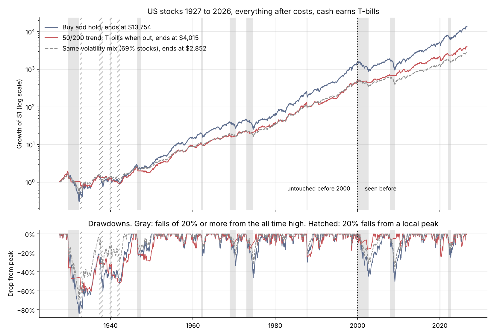
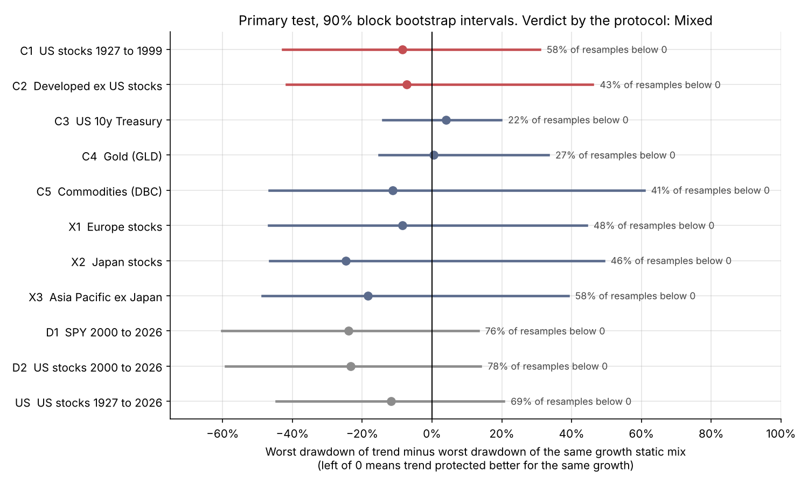
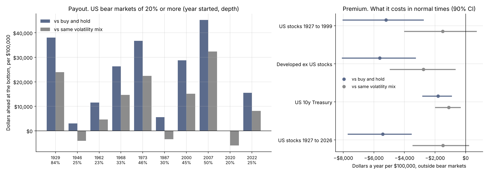
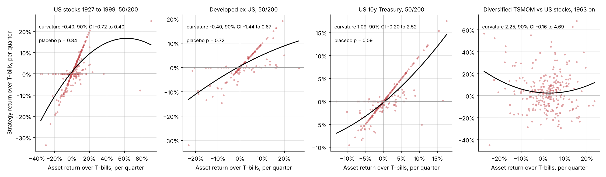

# Is Trend Following Worth It as Portfolio Protection?

Trend following cut losses in almost every big US bear market since 1927, but just holding about 70% stocks and 30% T-bills did roughly as well for the same growth. On data I hadn't touched, trend's edge over that simple mix was too small to tell apart from luck.

I tested the 50/200 day moving average rule (hold stocks when the 50 day average is above the 200 day one, T-bills otherwise) on a century of US stocks and 35 years of markets outside the US. I wrote the rules down and froze them before running anything.

* In US stocks from 1927 to 2026 the rule lost less than buy and hold in 9 of the 10 falls of 20% or more from the market's all time high, and was about $21,000 ahead per $100,000 at the bottom. Four of those ten are after 2000, years I had already studied.
* That protection cost about $5,400 a year per $100,000 in normal times, and the rule missed rebounds. In the 12 months after the March 2020 low the market made 64.6% and the rule made 27.8%.
* Against a 70/30 mix of stocks and T-bills it was about a wash, 0.3% a year ahead with an interval from -1.3% to +1.9%.

My precommitted test came out "Mixed". The full write up is in `paper/main.pdf`, and every number below comes from `results/study.json`.



## Try it

```bash
pip install -r requirements.txt
python -m trendlab today                                       # what each rule says on the latest data (research, not advice)
python -m trendlab backtest configs/us_century_50_200.toml    # headline numbers for any config
python -m trendlab tearsheet configs/us_century_50_200.toml --format both   # full report as pdf and html
python -m trendlab sweep configs/us_century_50_200.toml --grid fast=20,50,100 --grid slow=150,200,250   # table and heatmap
python -m trendlab backtest my_prices.csv --rule ema_crossover --set rule.fast=20 --set rule.slow=100    # your own prices
make all                                                       # tests, the notebook, the whole study and the paper
```

An example report is in `reports/example/` as a PDF and as a single html page. `python -m trendlab --help` lists every command, and `docs/usage.md` has the config reference. `make all` and `make paper` need LaTeX (`latexmk` and `pdflatex`), everything else is plain Python.

## The question

My first version of this project asked whether the golden cross beats buy and hold on SPY. It doesn't (that study is still in `backtest.ipynb`). But that was never a fair question. A rule that sits in cash about a quarter of the time should grow less money. So should holding 70% stocks and 30% T-bills. The useful question is this one.

> Is trend following economically useful as portfolio protection even when it underperforms buy and hold in absolute returns?

To answer it I compare trend with passive mixes of the same asset and T-bills that have the same volatility or the same long run growth, not only with 100% stocks.

## Results

### The primary test, fixed in `docs/protocol.md` before I looked

For each market I find the stock and T-bill mix that grew at the same CAGR as the trend rule, then compare their worst drawdowns. Below zero means trend protected better for the same growth. Intervals are a 12 month block bootstrap with 2,000 resamples.

| Untouched sample | Trend CAGR | Trend max DD | Same growth mix max DD | Difference | 90% interval | Resamples below 0 |
|---|---|---|---|---|---|---|
| US stocks, 1927 to 1999 | 9.0% | 61.5% | 69.9% (70% stocks) | -8.4 pts | -43 to +31 | 58% |
| Developed ex US, 1991 to 2026 | 5.6% | 31.5% | 38.7% (63% stocks) | -7.2 pts | -42 to +46 | 43% |

To count as "supported" the difference had to be below zero in at least 90% of resamples in both markets. It has the right sign in both but is nowhere near that bar. The test also doesn't have much power. With intervals this wide the rule would have needed a drawdown roughly 30 points shallower than the mix to pass, because the worst drawdown of a market's whole history comes down to one or two episodes. On the Ulcer index, which counts every drawdown by its depth and length, the mix did better in US stocks (by 6.2 points) and about the same outside the US.



### What the insurance costs, in dollars

Per $100,000, US stocks 1927 to 2026. A bear market here is a fall of 20% or more from the all time high, measured from the peak to the low, which is the definition I fixed in the protocol.

| Compared with | Cost a year in normal times | Bear markets where trend did better | Average dollars ahead at the bottom | Net, all months |
|---|---|---|---|---|
| Buy and hold | $5,416 (90% CI $3,571 to $7,680) | 9 of 10 | $21,083 | -1.2% a year |
| Same volatility mix (69% stocks) | $1,488 (90% CI -$179 to $3,445) | 7 of 10 | $10,781 | +0.3% a year (CI -1.3 to +1.9) |

Against buy and hold the insurance is real and it pays out almost every time. Against just holding less stock, the payout and the cost come out to about zero. Trend mostly moves the losses around. It does better in bear markets and gives a lot of it back in the recoveries after them, about 7% a year behind the mix in those months.

That definition has a blind spot. Because the 1929 high wasn't regained until 1945, the second big fall of the Depression (1937 to 1938, when buy and hold lost half) and the fall of 1940 to 1942 count as "recovery" months. So I also dated bear markets the usual way, as a 20% fall from a local peak. That gives 14 US bear markets instead of 10. Trend did better than buy and hold in 12 of them and better than the mix in 9. The conclusion doesn't change. The paper has the table.



### When it helps and when it fails

| Episode | Buy and hold | 50/200 trend | Same volatility mix |
|---|---|---|---|
| 1929 to 1932 | -83.9% | -45.9% | -69.8% |
| 1973 to 1974 | -46.4% | -9.6% | -32.0% |
| 1987 crash | -29.8% | -24.2% | -20.8% |
| 2000 to 2002 (seen before) | -44.6% | -15.8% | -31.5% |
| 2008 (seen before) | -50.2% | -4.9% | -37.3% |
| 2020 (seen before) | -20.1% | -20.1% | -14.1% |
| 2022 (seen before) | -24.9% | -9.4% | -17.5% |

It shines in slow bear markets and does little in fast crashes. In 1987 and 2020 the market fell faster than a 200 day average can move, so the rule was still in when the crash hit, then sold near the low and missed the rebound.

### Is it real convexity, or luck?

Trend following is often sold on its "smile", doing well when markets move a lot in either direction. On quarterly returns the 50/200 rule on stocks has no smile. The curvature is -0.40 for US stocks before 2000 (90% CI -0.72 to 0.40), and a placebo that shifts the same positions to random dates gets a curvature at least that big 84% of the time. It isn't one odd quarter either. Dropping the biggest one (1933 Q2, when the market rose 91%) makes it -0.60. A time series momentum portfolio in the Moskowitz, Ooi and Pedersen style, across seven markets in four asset classes, does have a positive curvature against US stocks (2.25), but its 90% CI of -0.16 to 4.69 includes zero.



### Did I just get lucky picking rules?

On US stocks before 2000 I ran all 96 rules this repo has ever touched (89 moving average pairs, the 10 month average, 12 month momentum with and without vol scaling, and four breakout rules) against their own same volatility mix. White's Reality Check gives p = 0.23 and Hansen's SPA gives p = 0.18. So even the best rule out of 96 isn't clearly better than holding less stock. Against plain buy and hold, none of the 96 rules had a higher average return.

### Everything else

* Other markets. Trend cut the worst drawdown against buy and hold in every market I tested. Against the same growth mix the point estimate favors trend in Europe, Japan, Asia Pacific and commodities and goes the other way for 10 year Treasuries and gold, and none of them come close to clearing the bootstrap. See `figures/primary_test.png`.
* Execution. Sharpe ratios barely move. Trading one day later costs about 0.02 of Sharpe, and waiting 10 days costs another 0.01 in US stocks and 0.03 outside the US. The drawdown comparison is much more fragile. At 50 bps a trade instead of 5, the difference shrinks from -8.4 to -1.5 points in US stocks and flips to +1.1 outside the US. It also jumps around with the delay (in US stocks it goes -11.6, -8.4, -3.8, -9.8, -8.1 and -15.7 points for delays of 0, 1, 2, 3, 5 and 10 days), because a few days decide where the rule sits at the bottom of one crash. See `figures/execution.png` and the table in the paper.
* Monte Carlo. Over 10,000 resampled 10 year paths, trend ended ahead of buy and hold 32% of the time and ahead of the same volatility mix 55% of the time. Its worst drawdown was smaller than the mix's in 50% of paths, a coin flip. Where it did help is the far tail, with a drawdown over 30% in 22% of paths against 33% for the mix and 57% for buy and hold. See `figures/monte_carlo.png`.
* A data trap. Free monthly gold data is usually monthly averages. Averaging makes returns look trendy (lag one autocorrelation 0.20 against -0.05 for real month end prices), and the 10 month rule beats holding gold on the averaged data (Sharpe 0.84 against 0.74) but loses on GLD over the same months (0.49 against 0.59). I didn't use the averaged series for any result.

## How it works

1. The protocol came first. `docs/protocol.md` and `docs/protocol_addendum.md` fix the question, the rules, the data, the benchmarks and the verdict rule. Their hashes are in `results/protocol_sha256.txt` and `run_study.py` refuses to run if either changes. Everything I added or fixed later is in `docs/deviations.md`.
2. SPY 2000 to 2026 was used to pick 50/200 and looked at many times, so it only counts as development. The confirmation data is US stocks 1926 to 1999 and developed markets outside the US from the Ken French data library. Bonds come from FRED yields through a bond pricing model that I checked against a real Treasury ETF (monthly correlation 0.990). Gold and commodities use the GLD and DBC funds. Sources are in `docs/data.md`.
3. The signal uses day t's close and the trade happens at day t+1's close. Cash earns the T-bill rate. Every position change pays 5 bps.
4. The benchmarks are stock and T-bill mixes with the same volatility, the same growth or the same average exposure, plus 60/40.
5. Uncertainty comes from block bootstrap intervals, a sign test across bear markets, placebo timing for the smile, and the Reality Check and SPA tests for data snooping.

The code is a small library, `trendlab/`.

| File | What it is |
|---|---|
| `trendlab/rules.py` | Moving average crossovers (simple and exponential), price above average, 10 month average, time series momentum, breakout, vol targeting |
| `trendlab/engine.py` | Delay, costs, cash at the T-bill rate, portfolios rebalanced monthly |
| `trendlab/config.py`, `trendlab/data.py` | Config files, sizing options, your own csv prices, the data snapshots |
| `trendlab/benchmarks.py` | Same volatility and same growth mixes, 60/40 |
| `trendlab/stats.py` | Block bootstrap, Reality Check, SPA, deflated Sharpe, PBO, Treynor and Mazuy |
| `trendlab/insurance.py` | Bear markets, premium and payout in dollars, regimes |
| `trendlab/sweep.py` | Parameter grids with heatmaps and walk forward tests |
| `trendlab/tearsheet.py`, `montecarlo.py`, `today.py`, `cli.py` | The command line tools and the pdf and html reports |
| `run_study.py`, `study_figures.py`, `paper_numbers.py` | The protection study, its figures and the numbers for the paper |
| `backtest_core.py`, `robustness.py`, `backtest.ipynb` | The first SPY study, now with the two bug fixes below |
| `data_sources.py`, `data/snapshots/` | Downloads and the small data files everything runs on |
| `tests/`, `test_backtest.py` | 123 tests, including no lookahead checks for every rule |

## Run your own tests

The library is not only for this study. Point it at any csv with a date column and a price column and it applies the same honest defaults, a one day delay, a cost on every trade and cash at the T-bill rate.

```bash
python -m trendlab init btc.toml --csv btc.csv        # starter config for your prices
python -m trendlab backtest btc.toml --set sizing.vol_target=0.15 --plot btc.png
python -m trendlab sweep btc.toml --grid fast=10:50:10 --grid slow=100:250:50 --metric calmar
python -m trendlab walkforward btc.toml --grid fast=10,20,50 --grid slow=100,200 --train-years 5 --folds
```

* Rules are the 50/200 crossover and its exponential version, price above an average, Faber's 10 month rule, 12 month time series momentum and Donchian breakouts. Any of them can be vol targeted, scaled to a fraction of full size or capped.
* A sweep scores every cell on the same dates and prints how much picking the best of N flatters the result, with the deflated Sharpe probability and the probability of backtest overfitting.
* Walk forward picks parameters on a training window, trades them on the next one and shows the out of sample result next to the fixed rule and buy and hold, plus the gap between training and test scores.
* Reports come as PDF, as one self contained html page, and as `summary.json`. Mistakes in a config or a csv stop the run with one line that says what to fix.

Everything is in `docs/usage.md`.

## Two bugs I found in my first version

The first version traded at the same close its signal came from, and cash earned 0%. Both are fixed, and `docs/changes.md` shows what each fix did. The old headline was 9.2% a year for the rule against 14.3% for SPY from 2018 on ($2.10 against $3.09 per dollar). With both fixes it is 9.3% against 14.3% ($2.12 against $3.09). Sharpe ratios are now over T-bills, so they're lower for both.

## Rerun it

```bash
pip install -r requirements.txt
make all        # about 15 minutes on 2 cores, needs LaTeX for the paper
```

`make test` runs the tests, `make study` reruns the study from the snapshots, `make data` downloads fresh data (the numbers will move a bit because the sources update).

## Limits

* Small samples where it matters. There are 6 bear markets in US stocks before 2000 and 4 in developed markets outside the US. Every statement about bear markets rests on a handful of episodes.
* Markets aren't independent. The developed markets sample overlaps the SPY years I'd already seen, and 2008 hit every stock market at once.
* The matching weights use the whole sample, so the same volatility and same growth mixes are picked with hindsight. So is trend's own CAGR. It's a comparison of what happened, not a strategy someone could have chosen in 1927.
* Index returns aren't tradeable before index funds. A 5 bps cost on the whole US market in 1932 is generous, and the drawdown comparison is sensitive to costs (see Execution above).
* Before 1953 the US data has Saturday sessions, so a 200 day average covers less calendar time than it does now.
* No taxes. Selling once a year in a taxable account would cost more than the trading costs.
* The bond series is a model, not a fund, and gold and commodities only go back to 2004 and 2006.
* The precommitment is only as good as my word. The protocol hashes sit in the same repo as the results. Uploading the protocol as its own earlier commit would make the timing checkable.
* The verdict depends on the benchmark. Against buy and hold, trend clearly protects. "Mixed" is about whether it protects better than owning less stock, which is the harder and more useful question.

## References

* Moskowitz, Ooi and Pedersen (2012), Time Series Momentum
* Faber (2007), A Quantitative Approach to Tactical Asset Allocation
* Hurst, Ooi and Pedersen (2017), A Century of Evidence on Trend-Following Investing
* White (2000), A Reality Check for Data Snooping. Hansen (2005), A Test for Superior Predictive Ability
* Treynor and Mazuy (1966), Can Mutual Funds Outguess the Market?
* Politis and Romano (1994), The Stationary Bootstrap
* Bailey and Lopez de Prado (2014), The Deflated Sharpe Ratio. Bailey, Borwein, Lopez de Prado and Zhu (2017), The Probability of Backtest Overfitting
* Working (1960), Note on the Correlation of First Differences of Averages in a Random Chain
* Data from the Kenneth R. French data library, FRED, Robert Shiller and Aswath Damodaran

## License

MIT
