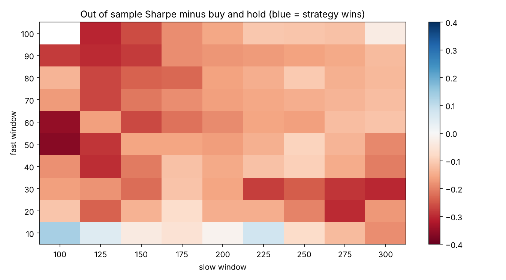

# Does a Simple Trend Following Strategy Beat Buy and Hold?

A backtest of the 50/200 day moving average crossover (the "golden cross") on SPY. I wanted to answer one question: after trading costs, on years the strategy was never tuned on, does it beat just holding the index? And then a second one, which turned out to be more interesting: how much should I trust that answer?

**Live report:** https://matinnikoo.github.io/momentum-backtest/

**Short answer:** no. From 2018 to 2026 the strategy returned 9.2% a year with a 0.63 Sharpe. Buy and hold returned 14.3% with a 0.79 Sharpe. Both had the same worst drawdown, 33.7%, because the 2020 crash was too fast for a 200 day average. On top of that, the checks below show that picking the "best" windows from history was close to a coin flip.

## How I tried to keep it honest

1. **No lookahead.** A signal from today's close gets traded at tomorrow's close (the `.shift(1)` in `backtest_core.py`).
2. **Trading costs.** Every time the position changes it pays 5 bps.
3. **Out of sample testing.** I picked the windows using 2000 to 2017 only, then tested once on 2018 to now.
4. **No cold start.** The averages need 200 days of history. My first version restarted them at the split, so the strategy sat in cash for most of 2018 for no reason. Now the signal is built on the full history and sliced, so it's warmed up on day one of the test. That moved the result from 8.4% to 9.2% a year, but the conclusion didn't change.

## Is it real or luck?

One test on one stretch of history can mislead, so `robustness.py` looks at it a few more ways.

| Check | What it asks | Result |
|---|---|---|
| Every window pair | Is 50/200 special, or would nearby pairs do the same? | Only 3 of 89 pairs beat buy and hold out of sample. In sample and out of sample Sharpe barely line up (correlation 0.13). |
| Walk forward | What if you re-pick the windows every January using only past data? | 2008 to 2026, Sharpe 0.65 vs 0.63 for buy and hold, smaller drawdown (36% vs 52%), but 8.1% a year vs 11.1%. |
| Stationary bootstrap | How sure can 8.5 years of data be? | Sharpe gap of about -0.15, 95% interval -0.50 to 0.22. The strategy wins in 19% of resamples. |
| Deflated Sharpe ratio | After counting how many rules I tried, is the winner's Sharpe still above zero? | Yes, about 0.99. Being in stocks most of the time makes money. Beating buy and hold is the hard part. |
| Probability of backtest overfitting | If you pick the best rule on half the data, how often is it below median on the other half? | 0.57 over 12,870 splits. Picking the best looking windows was no better than picking at random. |
| Costs | Did trading costs sink it? | No. It only trades about once a year, so Sharpe barely moves from 0 to 50 bps. |

So the rule isn't useless. It acts like insurance: it helped a lot in the slow 2008 crash, it costs you in bull markets, and it can't react to a fast crash like 2020. But the idea that tuning the windows on history gives you an edge didn't hold up.



## What's in the repo

| File | What it is |
|---|---|
| `backtest.ipynb` | The full analysis, from the data to the robustness checks and conclusions |
| `backtest_core.py` | The strategy, cost and metrics code |
| `robustness.py` | Parameter sweep, walk forward, bootstrap, deflated Sharpe and PBO |
| `test_backtest.py` | Tests for the lookahead shift, cost math, warm up, and the robustness functions on fake data |
| `spy_prices.csv` | Cached SPY prices so runs are reproducible |
| `figures/` | Charts used in this README |
| `index.html` | The notebook exported as a web page, which is the live report |
| `requirements.txt` | Dependencies |

## Run it

```bash
pip install -r requirements.txt
python test_backtest.py        # checks everything, runs offline
jupyter notebook backtest.ipynb
```

The prices are already in `spy_prices.csv`. If you delete it, the first run downloads about 26 years of SPY data with `yfinance`.

To rebuild the live report:

```bash
jupyter nbconvert --to notebook --execute --inplace backtest.ipynb
jupyter nbconvert --to html backtest.ipynb --output index.html
```

## Limitations

* Sharpe assumes a 0% risk free rate. Counting interest on cash would help the strategy a little.
* It's one asset. The same checks on other indexes would make the conclusion stronger.
* Trades fill at the close with a flat 5 bps cost. No taxes or slippage.

## References

* Bailey and Lopez de Prado (2014), The Deflated Sharpe Ratio
* Bailey, Borwein, Lopez de Prado and Zhu (2014), The Probability of Backtest Overfitting
* Politis and Romano (1994), The Stationary Bootstrap

## License

MIT
